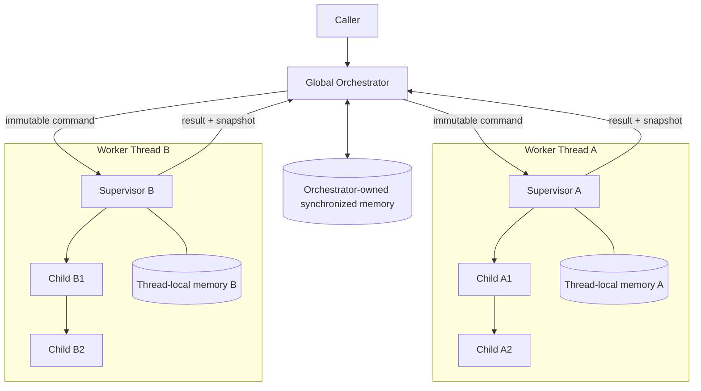
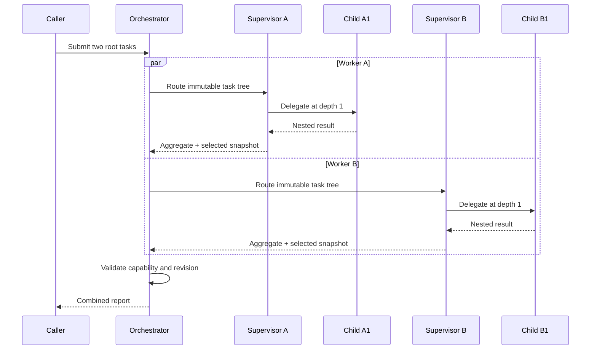

# Cross-Thread Multi-Agent Orchestration with Nested Sub-Agent Delegation

**Cross-Thread Multi-Agent Orchestration with Nested Sub-Agent Delegation
(CTMAO-NSD)** is this repository's name for an experimental Python concurrency
pattern and reference runtime. It combines isolated, thread-owned executors
with bounded hierarchical task execution and orchestrator-mediated state
exchange.

> **Scope of v0.4.2:** the default runtime remains deterministic and task trees
> remain caller-declared. This release adds a host-fed Codex conference bridge,
> a packaged Codex skill, run-scoped presentation state, and a responsive
> conference UI. Models cannot bypass runtime limits, and the bridge never reads
> Codex storage or private reasoning.

This standard-library-only implementation is intended for concurrency research,
experiments, and teaching. Its deterministic runtime demonstrates a control
plane and safety boundaries; the optional model-runtime contract can call an
application-supplied provider without granting it orchestration authority. No
provider implementation or credentials are bundled. It does not depend on LangGraph, CrewAI,
AutoGen, Swarm, Semantic Kernel, or another orchestration SDK.

## Relationship to the AI Product Framework

This repository is the standalone execution-engine reference. The
[AI Product Framework](https://github.com/bundleguard/ai-product-framework)
governs discovery, architecture selection, approval gates,
implementation, verification, deployment, and retrospectives. It may select
CTMAO-NSD when a product genuinely needs isolated concurrent agent runtimes, but
the two repositories remain independent:

- the AI Product Framework has no runtime dependency on this Python package;
- CTMAO-NSD does not embed product-specific workflows or framework policy; and
- consuming products integrate through adapters while preserving the engine's
  thread-ownership, delegation, and synchronization invariants.

> CTMAO-NSD is not a distributed consensus protocol, process sandbox, durable
> workflow engine, or claim of secure memory isolation. Python threads share a
> process; isolation here means enforced ownership and message boundaries.

## Architectural pattern

CTMAO-NSD is a concurrency architecture in which multiple isolated worker
threads each own a supervisor executor, an asynchronous runtime, and
thread-local state; supervisors route caller-declared work through bounded
parent-child execution trees; and all permitted state exchange between threads
is mediated by a global orchestrator through immutable messages and controlled
synchronization.

The pattern has two inseparable mechanisms:

- **Cross-Thread Multi-Agent Orchestration** governs worker lifecycle, routing,
  scheduling, correlation, failure boundaries, synchronization-capability
  passing, and selected state transfer between isolated runtimes.
- **Nested Sub-Agent Delegation** governs execution of caller-declared
  hierarchical task trees, supervisor-child routing, recursive execution,
  ancestry checks, depth and fan-out limits, timeout propagation, and
  deterministic result aggregation.

They are complementary responsibilities within one architecture—not competing
architectures.

### Architectural invariants

1. A worker thread owns its event loop, supervisor, child agents, and mutable
   local memory.
2. Workers never hold references to one another and never mutate another
   worker's state.
3. Cross-thread commands and results use immutable dataclass envelopes.
4. Selected memory crosses a worker boundary only as an allowlisted snapshot
   authorized by a single-use synchronization capability.
5. The orchestrator is the sole owner of synchronized memory.
6. The root supervisor is delegation depth `0`; a child at the configured
   maximum depth is allowed, but another child below it is rejected.
7. Depth and direct-child limits are validated before a child branch is
   scheduled.
8. One absolute deadline is inherited by the entire delegation tree.
9. Results and failures propagate upward and retain worker, task, and agent-path
   identity.

## Execution model



The arrows are logical message paths. They do not represent direct mutation of
another worker's memory.



The orchestrator creates the main event-loop inbox. Each non-daemon worker
thread creates and closes its own `asyncio` event loop and all loop-bound
resources inside that thread. Transfer between loops uses
`call_soon_threadsafe`; no event loop consumes an `asyncio` primitive owned by a
different loop.

## Core concepts

### Global orchestrator

`Orchestrator` accepts root assignments, issues correlation IDs and
synchronization capabilities, routes commands, collects results, publishes
approved snapshots, and coordinates bounded shutdown. It does not execute child
work or expose worker-local mutable state.

### Worker runtime and supervisor agent

`WorkerThread` owns one OS thread and one event loop. The supervisor inside that
runtime is the only root-routing authority. It validates the caller-supplied
root fan-out, creates child contexts once, and aggregates results in declared
order. It does not select a model, invent tasks, or choose specialists.

### Child agents and delegation contexts

`ChildAgent` is a deterministic runtime executor, not a model-backed AI agent.
It executes a node and may recursively route its declared children. Every child
inherits immutable lineage, agent path, policy, and the root's absolute
deadline. Reusing an ancestor task ID triggers circular-delegation rejection.

### Thread-local and synchronized memory

`ThreadLocalMemory` records its constructing thread's identity and rejects
foreign-thread access at runtime. Its snapshots contain only allowlisted keys.
`SharedMemoryHub` accepts a snapshot only when:

- its capability belongs to the same worker;
- the capability has not already been consumed; and
- its revision is newer than the currently published revision.

Visibility is explicit and eventual: a private write is not synchronized until
the worker returns a snapshot and the orchestrator validates it. The reference
implementation publishes results; routing selected synchronized context into a
later assignment is an application-level policy.

## Safety and bounded execution

| Policy | Default | Effect |
| --- | ---: | --- |
| `MAX_DELEGATION_DEPTH` | `3` | Rejects a child whose depth would exceed the bound. |
| `MAX_CHILDREN_PER_AGENT` | `4` | Rejects excessive direct fan-out before scheduling. |
| `TASK_TIMEOUT` | `5.0 s` | Supplies one absolute deadline to the full execution tree. |
| `THREAD_SYNC_INTERVAL` | `0.05 s` | Reserved cadence for heartbeat/lifecycle extensions. |
| `MEMORY_SYNC_INTERVAL` | `0.25 s` | Reserved cadence for periodic snapshot extensions. |

Depth and fan-out bounds prevent unbounded recursive tree growth through the
delegation API. Lineage checks reject task-ID cycles. The shared absolute
deadline contains stalled asynchronous work, and thread ownership plus message
passing removes cross-worker lock ordering from the reference path. These rules
do not prevent every possible application loop, retry storm, CPU starvation, or
blocking call; extensions must preserve and supplement the safety model.

## Failure isolation

- A child exception becomes a typed failed result rather than crossing the
  thread boundary as a live exception object.
- A child rejection or timeout propagates upward, causing its branch and root
  aggregate to report failure while retaining partial child results.
- One worker's task failure does not cancel work assigned to another worker.
- A fatal worker-runtime error is reported through a `WORKER_FAILED` envelope.
- Shutdown is cooperative and bounded. `Orchestrator.close()` cancels active
  worker root coroutines, keeps the caller event loop responsive, and joins all
  worker threads before returning.

Automatic worker restart, durable replay, retry policy, and process-level crash
recovery are intentionally future concerns.

## Quick start

Requires Python 3.11 or newer.

```bash
python -m venv .venv
python -m pip install --editable .
python main.py
```

The demonstration starts two isolated workers. Supervisor A delegates `Child
A1` to `Child A2`, while Supervisor B independently delegates `Child B1` to
`Child B2`. Both result trees return to the orchestrator, which publishes only
their selected memory snapshots.

Run the test suite with no test-framework dependency:

```bash
python -m unittest discover -s tests -v
```

## Live Agent Conference

The additive observability layer turns genuine runtime facts into a live local
dashboard and spoken conference. It does not expose private reasoning or invent
dialogue. Every transcript turn retains its source event ID, and redaction runs
before browser or speech presentation.

```bash
python examples/live_conference.py
```

Open the printed loopback URL; the normal demo waits for its first listener
before beginning. It exchanges controlled, explicitly supplied findings through
a nested delegation, contains one intentionally failed branch, and shows the
resulting delegation tree and source-backed transcript. Conference/Briefing
mode, global and per-agent mute, per-agent voice overrides, and locally installed
browser voices are available. Use `--hold 0` for an automated smoke run. Audio
is optional: transcript-only mode and the `NullSpeechProvider` work without a
speech service.

Normalized events are available in `OrchestrationReport.normalized_events` and
through an optional failure-isolated `EventBus`. The legacy `events` report
field remains available for v0.1 compatibility.

## Interactive conference

The local dashboard uses an evidence-first layout: the source-backed public
record and final decision are primary, while a compact workflow shows the fixed
Researcher/Builder fork, Reviewer join, and all three cited inputs to Moderator.
Connections become accepted only when the downstream public message cites the
exact prior message events; they do not imply direct agent communication or
execution order. Human-readable evidence and redaction status appear before raw
technical identifiers.
See [visual reference attribution](docs/third_party/synthetic-visuals-5.md).

Start the offline interactive application:

```bash
python examples/interactive_conference.py
```

Open the printed tokenized loopback URL, enter an objective, and select **Start
conference**. Researcher and Builder contribute concurrently; Reviewer receives
their actual public outputs; Moderator receives all three messages and produces
the final decision. The deterministic demo is clearly labeled and performs no
model or network call.

For a real model-backed conference, explicitly select the OpenAI provider:

```powershell
$env:OPENAI_API_KEY = "your API key"
python examples/interactive_conference.py --provider openai --model gpt-5.4
```

This sends the objective and public participant messages to the
[OpenAI Responses API](https://developers.openai.com/api/reference/resources/responses/methods/create).
The key remains in the host process and is not copied into events. Requests use
`store: false`; provider and account retention policy still applies. API use may
incur charges. Never paste an API key into the conference task box.

## Conference a Codex task

v0.4.2 includes a repository-contained Codex plugin at
`plugins/agent-conference`. When the skill is installed and the user invokes
`$agent-conference` or asks to conference the current task, the current Codex
task remains authoritative while the local page follows genuine public results
from bounded Codex subagents.

The conference page is an observability surface, not a second task composer.
The skill starts Researcher and Builder on independent bounded work, gives the
Reviewer their actual results, and leaves the main Codex task responsible for
moderation, integration, verification, and the final answer. Only explicit
public final messages are published. Source references are stored as digests;
private reasoning, prompts, raw tool arguments, credentials, and environment
values are excluded.

The plugin and bridge negotiate protocol `1.1`. A stale installed plugin fails
with a reinstall instruction instead of silently producing an incomplete
Reviewer or Moderator record. The plugin requires this CTMAO-NSD checkout; it
is workflow glue for the repository bridge, not a standalone dashboard.

### Install or update the Codex plugin

The current development distribution is the personal marketplace plugin
`agent-conference@personal`. Install it, or refresh an existing installation,
from a terminal where the same personal marketplace is configured:

```powershell
codex plugin add agent-conference@personal --json
```

The returned JSON identifies the installed version; it must be `0.4.2` for this
checkout. Start a new Codex task in this repository and invoke
`$agent-conference`. The skill resolves the repository root, verifies
`examples/codex_conference_bridge.py`, negotiates bridge protocol `1.1`, and
prints an authenticated loopback dashboard URL. The dashboard process requires
Python 3.11 or newer but does not require Docker.

If Codex reports a plugin/bridge incompatibility, run the install command again,
restart the conference, and confirm the task is attached to this repository.
Do not open `tests/browser/dashboard.html` as the product UI; that file is only
the synthetic regression runner.

For bridge development or host integration, start it directly:

```powershell
$env:PYTHONPATH = "src"
python examples/codex_conference_bridge.py serve `
  --objective "Review the current Codex task" `
  --plugin-protocol-version 1.1
```

The first JSON line contains the tokenized loopback URL and a private temporary
session-file path. The included plugin scripts feed participant states, public
messages, and the terminal result through authenticated loopback endpoints. The
bridge intentionally does not launch a nested Codex process or attach to an
arbitrary existing desktop task on its own.

Audio is disabled initially. Enabling it is an explicit browser action, and the
dashboard distinguishes the latest contribution, queued speech, actual speech,
pause, mute, unavailability, and provider failure. Use `view=v4`, `view=v3`, or
`view=legacy` to inspect earlier presentation revisions.

To run the browser regressions on Windows, run
`.\tests\run_browser_dashboard_smoke.ps1`, then open its printed loopback URL.
The launcher resolves a real Python runtime, preserves an existing `PYTHONPATH`,
and adds this checkout's `src` directory. On other platforms, set
`PYTHONPATH=src` and run `python tests/browser_dashboard_smoke.py`.
Do not open `tests/browser/dashboard.html` directly; it is served as part of the
harness and cannot load the production dashboard over a `file://` URL.
The harness runs the production dashboard at 1440px, 768px, and 360px with
synthetic source records and controlled speech callbacks. It checks evidence
links, responsive layout, accessible controls, speech lifecycle, partial
failure, cancellation, reconnect, and new-run reset without model calls,
audible playback, or additional dependencies. Refreshing the harness creates
fresh dashboard frames. Real bridge transport and exact four-role receipts
are covered separately by `test_plugin_http_client_four_role_handshake_receipts_and_finish`.

## Agent runtime boundary

`DeterministicRuntime` remains the default. `ModelBackedRuntime` defines an
optional provider-neutral node-execution boundary; it does not grant a model
authority to create tasks, change delegation, or bypass deadlines. No vendor
provider or credentials are bundled. Applications can supply a thread-owned
runtime factory and contract-test it with their own adapter.

## Codex external adapter prototype

The standard-library-only `CodexExecJsonlAdapter` is a prototype for record
shapes currently observed from `codex exec --json`. It observes explicit
thread, turn, message, and tool lifecycle records from a compatible host-fed
stream; it never launches Codex, reads credentials, or consumes reasoning
items. Agent-message text is disabled by default and must be explicitly enabled.

```bash
codex exec --json "summarize the repository" \
  | python examples/codex_jsonl_adapter.py
```

For an opted-in transcript, add `--include-message-text`; redaction still runs
before normalized output. Keep Codex stderr separate from stdout. The adapter
does not infer nested-agent identity or delegation when the stream does not
expose it. `CodexThreadSnapshotAdapter` additionally accepts a schema-v1 task
snapshot supplied by an authorized host integration; it does not treat
`codex://` deep links as an API.

## Repository layout

```text
src/ctmao_nsd/  Runtime, normalized events, observability, conference, speech,
                local UI, Codex bridge, model-runtime, and adapter modules
tests/          Standard-library runtime, concurrency, privacy, UI, speech,
                conference, and adapter tests
examples/       Deterministic runtime, live conference, and Codex bridge demos
plugins/        Repository-contained Codex plugin and Agent Conference skill
docs/           Architecture, protocols, operating guidance, and ADRs
main.py         Original deterministic two-worker demonstration
```

## Benefits

- **Bounded delegation:** depth and fan-out checks constrain execution-tree
  growth before unsafe children are scheduled.
- **Clear ownership:** every mutable local store has one owning runtime.
- **Controlled synchronization:** state movement is explicit, revisioned,
  capability-authorized, and testable.
- **Failure containment:** outcomes preserve child, supervisor, and worker
  boundaries without turning every task failure into global cancellation.
- **Traceable decomposition:** task IDs, correlation IDs, worker IDs, agent
  paths, events, and revisions support diagnosis.
- **Framework independence:** execution has no third-party runtime dependency.

## Trade-offs and limitations

- Python threads do not provide process or security isolation.
- v0.4.0 performs no model call by default. The optional OpenAI provider requires
  explicit launch selection and a host-supplied credential. Autonomous planning,
  provider-managed tools, and model-token budget enforcement are not implemented.
- Task trees are caller-declared; supervisors do not dynamically create or
  select work.
- `SyncToken` is a single-use memory-synchronization capability. It is unrelated
  to LLM input/output token accounting.
- CPU-bound Python work remains constrained by the CPython GIL; processes or
  native extensions may be more appropriate.
- Central orchestration and snapshot validation add latency and can become a
  throughput bottleneck.
- In-memory transport is not durable after process termination.
- Cancellation across threads is cooperative, not forced.
- A supervisor processes its declared root branches deterministically; an
  application can add bounded sibling concurrency while retaining the same
  ownership and deadline rules.
- The interval constants are extension points in v0.x, not background polling
  loops required for correctness.
- `Orchestrator.run()` is intentionally single-flight. A second overlapping call
  raises `OrchestratorBusyError`; all worker envelopes still pass through one
  central correlation dispatcher.
- Calling `close()` during a run cancels that run with
  `OrchestrationCancelledError`. Cancellation is cooperative at awaited Python
  boundaries; blocking native or synchronous calls require their own policy.

See [Hardening status](docs/hardening.md) for verified alpha limitations.

## Future extensions

- A public executor protocol for product-defined task handlers
- Optional model-backed executor adapters outside the standard-library core
- Policy-driven dynamic task planning that preserves depth, fan-out, and
  deadline bounds
- Explicit LLM context and token-budget policies, separate from `SyncToken`
- Durable message transport and restartable assignments
- Pluggable task executors and supervisor routing policies
- Heartbeats, explicit health states, drain policies, and worker restart
- Compare-and-swap context import into subsequent assignments
- Process or remote-worker transports using the same immutable envelopes
- Metrics, tracing adapters, persistence, authentication, and governance hooks

## Terminology and scope

The first use of the name is **Cross-Thread Multi-Agent Orchestration with
Nested Sub-Agent Delegation (CTMAO-NSD)**; later references use **CTMAO-NSD**.
This exact name is canonical only within this repository. "Agent" names an
execution role in this version; it does not imply LLM use or autonomous
decision-making. The implementation is an experimental reference, not a claim
of legal exclusivity, novelty, external recognition, or industry
standardization.

Build-time Codex sub-agents used to help review this repository are unrelated to
the runtime agents demonstrated by CTMAO-NSD.

## License

MIT. See [LICENSE](LICENSE).
